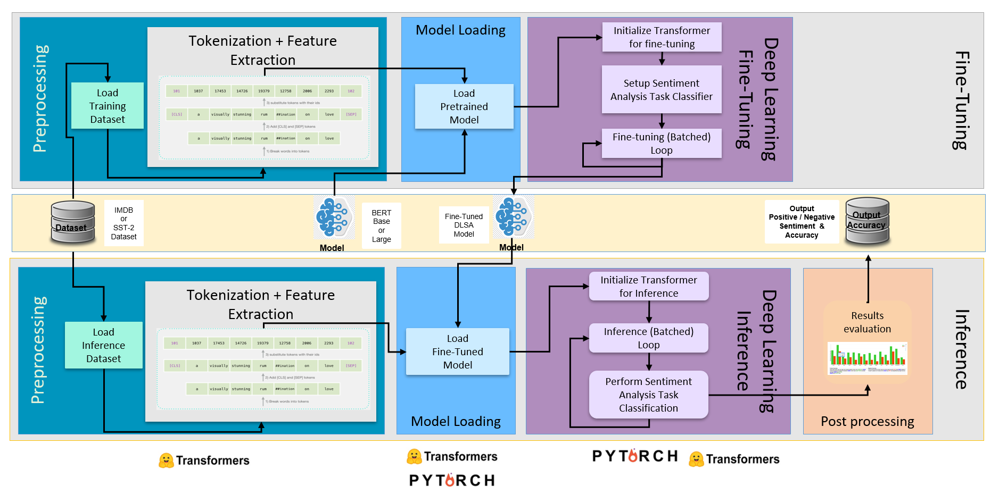

# E2E DLSA
DLSA is Intel optimized representative End-to-end Fine-Tuning & Inference pipeline for Document level sentiment analysis using BERT model implemented with Hugging face transformer API. the code supports single node and multinode implementations.

Please see the GitHub page for the details.
https://intel.github.io/document-level-sentiment-analysis/